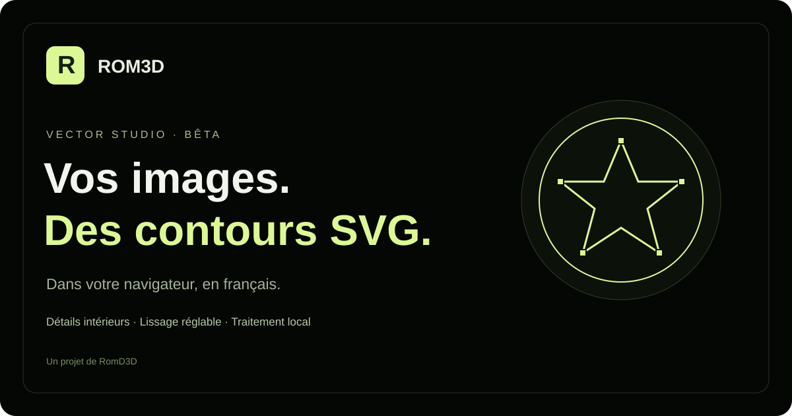

# Rom3D Vector Studio



**Des images aux contours SVG, directement dans votre navigateur.**

Rom3D Vector Studio transforme des logos et silhouettes en tracés vectoriels. L’interface en français propose un thème noir, une comparaison original/vecteur et les réglages nécessaires pour préparer un SVG destiné au dessin ou à une esquisse de CAO.

**Version 0.7.0-bêta — projet de RomD3D.**

## Essayer en ligne

👉 **[Ouvrir Rom3D Vector Studio](https://romd3d.github.io/rom3d-vector-studio/)** — aucune installation ni connexion nécessaire.

Le calcul et le téléchargement SVG ont été vérifiés sur le site publié avec l’exemple intégré.

## Ce que vous pouvez faire

- Importer un PNG, JPG, WEBP ou BMP, par sélection ou glisser-déposer.
- Extraire des contours sans remplissage ou des formes pleines.
- Conserver les petites zones de couleur et les détails intérieurs.
- Fusionner les dégradés gris pour éviter des séparations parasites.
- Ajuster le lissage, le seuil, le nettoyage et l’épaisseur du trait.
- Comparer le résultat avec l’original et zoomer.
- Choisir un fond blanc ou noir pour la zone de travail.
- Télécharger un SVG avec une largeur physique en millimètres et, en option, un fond intégré.

Le traitement des images s’effectue sur votre appareil. Les images ne sont pas envoyées à un serveur de vectorisation. Les polices Google peuvent être chargées séparément ; sans réseau, les polices système prennent le relais.

## Démarrer sur votre ordinateur

Aucune compilation ni clé d’API n’est nécessaire. Un petit serveur local est requis pour le calcul en arrière-plan :

```bash
python3 -m http.server 8080
```

Ouvrez ensuite **http://localhost:8080** dans Chrome depuis le dossier du projet.

## Publier une version web avec GitHub Pages

Ce dossier contient l’application à la racine et un fichier `.nojekyll`.

1. Déposer ces fichiers dans un dépôt GitHub public.
2. Ouvrir **Settings → Pages**.
3. Choisir **Deploy from a branch**, branche **main**, dossier **/(root)**, puis **Save**.
4. Attendre le déploiement et utiliser le lien affiché par GitHub.

Référence : [configuration officielle de GitHub Pages](https://docs.github.com/en/pages/getting-started-with-github-pages/configuring-a-publishing-source-for-your-github-pages-site).

## Bien régler le tracé

Pour un logo détaillé, commencez avec **Conserver les détails fins**, **Ignorer les dégradés gris** et un lissage **Équilibré**. Diminuez le lissage si les petites formes deviennent trop arrondies.

Décochez **Retirer le fond relié aux bords** si cette suppression enlève une partie du dessin. L’option **Inclure ce fond dans le SVG** ajoute un rectangle de fond au fichier exporté ; laissez-la décochée pour obtenir des contours sur fond transparent.

Un export SVG peut être importé dans une esquisse de CAO. Vérifiez ses dimensions, ses contours fermés et les éventuels doublons avant une extrusion.

## Limites de la bêta

Le tracé reste une approximation de l’image de départ. Les images floues, les dégradés colorés et les zones très fines peuvent produire des irrégularités. La séparation des couleurs peut laisser des contours voisins. Un cercle pixellisé n’est pas automatiquement reconstruit en cercle géométrique parfait.

L’import est limité à 20 Mo et 50 millions de pixels ; le calcul réduit la plus grande dimension à 1 600 pixels. Les photos complexes peuvent être longues à traiter. L’export DXF et les installateurs DMG/EXE ne sont pas inclus.

## Organisation

- `index.html`, `style.css`, `app.js` : interface et export.
- `trace.js` : préparation des couleurs, nettoyage et tracé.
- `worker.js` : calcul en arrière-plan.
- `vendor/potrace.js` : moteur Potrace compilé en WebAssembly.
- `vendor/potrace-source/` : sources du moteur correspondant au fichier intégré.
- `docs/` : guide de publication et notes de version.
- `marketing/` : visuel et textes d’annonce à adapter avant diffusion.

## Licence et crédits

Distribution sous **GNU GPL version 2**. Voir [LICENSE](LICENSE) et [THIRD_PARTY_NOTICES.md](THIRD_PARTY_NOTICES.md).

Le projet utilise Potrace de Peter Selinger, porté en WebAssembly par Igute Chung. Les sources amont fournies correspondent au commit `915827349e6ce7c9b8077e9442b95c1d775c4cef` ; son fichier `index.js` est identique octet par octet au moteur distribué dans `vendor/potrace.js`.
